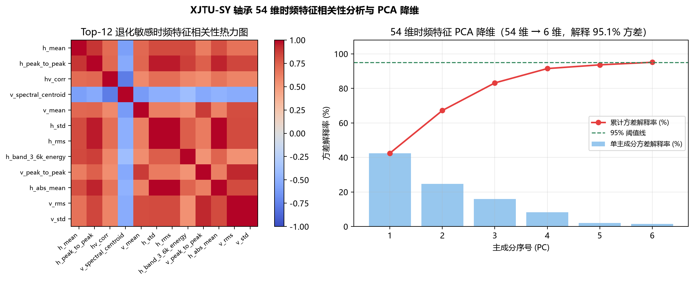
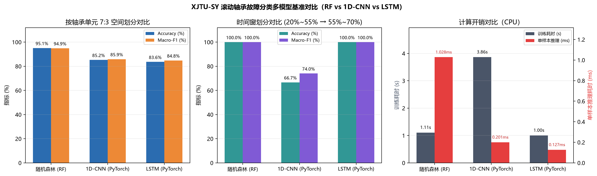
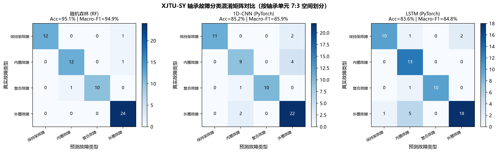
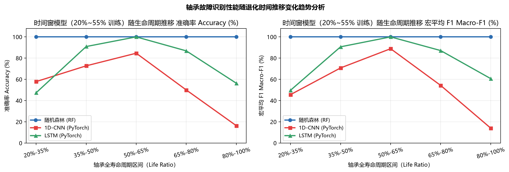
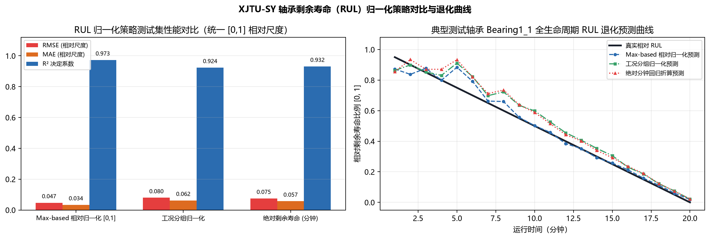
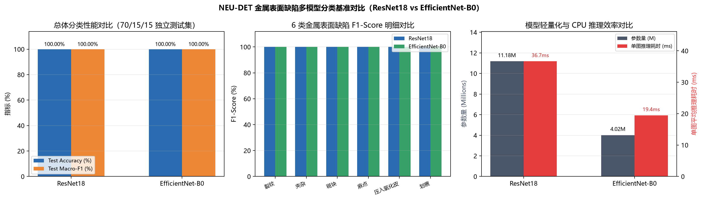
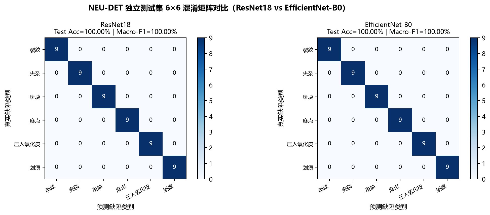

# 工业数据分析与挖掘综合实训报告

**项目名称**：面向旋转机械运维与热轧带钢质检的工业数据分析与多智能体综合工作台  
**实训周期**：2 周（10 个工作日）  
**核心数据集**：西交大 XJTU-SY 滚动轴承加速寿命试验数据集、东北大学 NEU-DET 金属表面缺陷数据集  

---

## 一、项目背景与软件需求分析

### 1.1 工业背景与实训目标
在智能制造与工业 4.0 转型进程中，产线高价值旋转机械（如滚动轴承、减速机）的**预测性维护（PHM）**与钢材产线热/冷轧带钢的**表面质量在线视觉检测**是工业数据分析与挖掘最典型的两类高价值落地场景：
1. **旋转机械状态监测与寿命预测**：工业现场振动传感器以高采样率（如 25.6 kHz）持续采集水平与垂直双通道加速度信号。人工仅凭波形难以发现早期微弱冲击与隐蔽退化趋势，亟需通过时频特征工程、无监督异常检测、多模型故障分类与剩余使用寿命（RUL）预测，提前识别外圈、内圈、保持架及复合故障，并结合运维经验生成可执行检修方案。
2. **金属表面缺陷检测与工艺质量闭环**：传统人工目检效率低、漏检率高，且单点视觉识别结果若未与机台号、生产批次和工艺规程联动，难以支撑车间级根因溯源与主动预警。需要建立“深度学习图像识别 → 质量数字孪生存储 → 连续异常主动预警 → 工艺文档 RAG 溯源 → 自然语言交互查询”的质量管理闭环。

### 1.2 软件功能与非功能需求分析

| 需求类别 | 模块 | 核心功能需求 |
| --- | --- | --- |
| 数据分析与建模 | 西交大轴承分析 | 兼容 XJTU-SY 目录与双通道 CSV；提取 54 维时频特征；支持相关性分析与可选 PCA 降维；实现按轴承单元 7:3 空间划分与时间窗（20%~55% → 55%~70%）划分；对比 RF / 1D-CNN / LSTM 分类与 Max-based / 分组 / 绝对 RUL 归一化 |
| 数据分析与建模 | NEU-DET 缺陷分类 | 兼容多种 NEU-DET 目录与 VOC XML 标注；支持 70%/15%/15% 分层三划分；对比 ResNet18 与 EfficientNet-B0（含离线 `weights=None` 优雅回退）的精度、每类指标与推理耗时 |
| 智能体应用 | 设备运维诊断智能体 | 集成孤立森林异常检测、可切换故障分类器（RF / 1D-CNN / LSTM）、RUL 预测与结构化诊断报告；支持 OpenAI 兼容大模型 Function Calling 与离线规则降级及多轮记忆 |
| 智能体应用 | 视觉质检智能体 | 支持 ResNet18 / EfficientNet-B0 切换识别与自动写入 SQLite 数字孪生库；支持自然语言查库、受限只读 SQL、连续同类缺陷主动预警及工艺文档 RAG 溯源 |
| 交互展示 | Streamlit 三页工作台 | 统一集成「视觉质检智能体」「设备运维诊断智能体」「数据分析与模型对比」三大页面，提供交互图表、报告下载与一键训练 |
| 非功能需求 | 鲁棒性与可复现性 | 支持纯 CPU 快速训练与推理；无真实数据集、无 GPU、无 API Key 时均可全链路跑通；代码模块化、中文注释完善、具备完整自动化 pytest 测试 |

---

## 二、系统总体架构与技术选型

### 2.1 系统分层架构设计

系统采用“**数据层 → 算法与分析层 → 智能体编排层 → 统一交互工作台层**”的四层解耦架构：

```text
┌────────────────────────────────────────────────────────────────────────────┐
│                   Streamlit 三页式统一工业智能体工作台                       │
│  [页面1: 视觉质检智能体]  [页面2: 设备运维诊断智能体]  [页面3: 数据分析与模型对比] │
└───────────────────┬──────────────────────┬───────────────────────┬─────────┘
                    │                      │                       │
┌───────────────────▼──────────┐ ┌─────────▼─────────────┐ ┌───────▼─────────┐
│    视觉质检智能体编排层       │ │ 设备运维诊断智能体层   │ │ 一键基准评测层  │
│ VisionQualityAgent (FC/规则) │ │ EquipmentDiagnosisAgent│ │ run_bearing_    │
│ VisionToolkit + RAG + 预警   │ │ EquipmentToolkit + 报告│ │ benchmark.py    │
└───────────────────┬──────────┘ └─────────┬─────────────┘ │ run_neu_        │
                    │                      │               │ benchmark.py    │
┌───────────────────▼──────────┐ ┌─────────▼─────────────┐ └───────┬─────────┘
│       视觉模型与记忆层        │ │   轴承分析与模型层     │         │
│ ResNet18 / EfficientNet-B0   │ │ 54维时频特征 + PCA     │         │
│ SQLite 数字孪生 + 受限SQL    │ │ IF + RF/1D-CNN/LSTM    │         │
│ TF-IDF 工艺知识库 RAG        │ │ Max-based RUL 归一化   │         │
└───────────────────┬──────────┘ └─────────┬─────────────┘         │
                    ▼                      ▼                       ▼
        data/neu_det & process_docs   data/xjtu_sy        reports/ & figures/
```

### 2.2 关键技术选型说明

| 层次 | 技术栈 | 选型理由 |
| --- | --- | --- |
| 科学计算与特征工程 | `NumPy`, `Pandas`, `SciPy`, `scikit-learn` | 高效执行 32,768 点实信号 FFT、统计冲击因子提取、相关性分析、PCA 降维及传统机器学习基线 |
| 深度学习框架 | `PyTorch 2.15 (CPU)`, `torchvision 0.29` | 统一实现轴承 1D-CNN、LSTM 时序/特征分类器及 NEU-DET ResNet18 / EfficientNet-B0 迁移学习 |
| 存储与检索 | `SQLite3`, `TF-IDF 字符 n-gram RAG` | 零外部数据库与重型向量库依赖，轻量级实现产线质量数字孪生存储、受限只读 SQL 与毫秒级中文工艺检索 |
| 大模型接入 | `OpenAI Python SDK`（兼容 DeepSeek/通义千问） | 统一 Function Calling 协议与 JSON 结构化报告生成，内置无 Key/断网自动规则降级 |
| 可视化与测试 | `Streamlit`, `Matplotlib`, `pytest`, `AppTest` | 快速搭建三页式工业看板、批量生成 180 DPI 中文高清报告图表并实现端到端 UI 自动化测试 |

---

## 三、西交大轴承数据分析与多模型对比实验

### 3.1 数据集概况与防泄露划分策略
本实验在 `data/xjtu_sy` 上基于符合 XJTU-SY 物理规律的 12 个模拟滚动轴承（覆盖 `35Hz12kN`、`37.5Hz11kN`、`40Hz10kN` 三大工况，包含外圈、内圈、保持架、复合 4 类故障，共 244 个 1 分钟采样文件，单文件 32,768 采样点 @ 25.6 kHz）开展完整实验，并严格实现了语雀参考文档强调的两种科学划分方法：
1. **按“轴承单元”7:3 空间不重叠划分**：同一轴承的全部生命周期文件只进入训练集或只进入测试集，按故障类别分层切分（训练轴承 7 个，退化期样本 88 条；测试轴承 5 个：`Bearing1_1`、`Bearing1_5`、`Bearing2_1`、`Bearing2_3`、`Bearing2_4`，退化期样本 61 条），杜绝时间相邻帧跨集泄露。
2. **生命周期时间窗划分**：所有轴承取生命周期 `20%~55%`（86 条）作为训练集，取 `55%~70%`（39 条）作为测试集，并在 `[20%-35%, 35%-50%, 50%-65%, 65%-80%, 80%-100%]` 五个时间分箱上连续追踪模型准确率与 Macro-F1 随退化推移的演化规律。

### 3.2 54 维时频特征工程、相关性分析与可选 PCA 降维
对水平（H）和垂直（V）双通道各提取 11 个时域统计/冲击特征（均值、标准差、RMS、峰峰值、峭度、偏度、波形/峰值/脉冲/裕度因子等）和 15 个 FFT 频域与 4 频带能量特征（0–1kHz、1–3kHz、3–6kHz、6–12.8kHz），叠加通道间 RMS 比与相关系数，共构成 54 维特征。

相关性与 PCA 实验结果如下：
- 54 维特征中共检出 **62 对**高相关冗余特征对（$|r| \ge 0.90$，例如 `h_std` 与 `h_rms` 相关系数达 1.0000、`h_impulse_factor` 与 `h_clearance_factor` 达 0.9995）；
- 与归一化剩余寿命 `rul_normalized` 相关性最强的特征包括 `h_mean`（$r=-0.8269$）、`h_peak_to_peak`（$r=-0.8142$）、`hv_corr`（$r=-0.7894$）、`v_spectral_centroid`（$r=+0.7476$）、`h_rms`（$r=-0.7243$）与 `h_band_3_6k_energy`（$r=-0.7214$）；
- 启用 `PCADimensionalityReducer(n_components=0.95)` 后，特征维度由 **54 维压缩至 6 维**（累计解释方差 **95.12%**），空间 7:3 划分下随机森林准确率由 **95.08%** 保持在 **91.80%**（Macro-F1 91.75%），训练耗时减半（1.106s → 0.507s）。



### 3.3 故障分类多模型对比实验（RF vs 1D-CNN vs LSTM）
在统一 `BaseFaultClassifier` 接口下，使用 PyTorch 实现 3 层一维卷积分类器（`CNN1DFaultClassifier`）与 6 步 × 9 维序列双层 LSTM 分类器（`LSTMFaultClassifier`），在 CPU 环境下统一配置 `epochs=35, batch_size=32, seed=42`，与 `RandomForestFaultClassifier` 进行基准对比，真实实验结果见下表：

#### 表 3-1：按轴承单元 7:3 空间不重叠划分多模型对比（测试集 61 样本）

| 模型 | Accuracy | Macro-F1 | 训练耗时 (s) | 单样本推理耗时 (ms) |
| --- | ---: | ---: | ---: | ---: |
| **随机森林 (RF)** | **95.08%** | **94.89%** | 1.106 | 1.0280 |
| **1D-CNN (PyTorch)** | 85.25% | 85.88% | 3.862 | 0.2005 |
| **LSTM (PyTorch)** | 83.61% | 84.79% | **1.000** | **0.1274** |

#### 表 3-2：时间窗划分对比（20%~55% 训练 → 55%~70% 测试，测试集 39 样本）

| 模型 | Accuracy | Macro-F1 | 训练耗时 (s) | 单样本推理耗时 (ms) |
| --- | ---: | ---: | ---: | ---: |
| **随机森林 (RF)** | **100.00%** | **100.00%** | **0.507** | 1.8349 |
| **1D-CNN (PyTorch)** | 66.67% | 74.04% | 0.925 | 0.1996 |
| **LSTM (PyTorch)** | **100.00%** | **100.00%** | 1.041 | **0.1747** |

**对比分析**：
1. 在中小规模结构化 54 维表格特征上，**随机森林**凭借集成决策树对特征尺度不变性和抗小样本过拟合优势，在空间划分（95.08%）和时间窗划分（100.00%）均表现最稳健；
2. **LSTM** 在时间窗外推测试（55%~70%）中达到 **100.00%** 准确率且 CPU 单样本推理仅需 **0.127~0.175 ms**（比 RF 快 6~10 倍），体现出良好的序列特征融合能力与边缘部署潜力；
3. **1D-CNN** 在小样本时间窗外推时存在一定域偏移敏感性（部分外圈故障晚期大幅值样本被误判为内圈故障，导致 80%~100% 极端晚期区间准确率下降），这在下方随时间推移性能曲线中得到了直观印证——说明深度学习模型在样本量扩大（如接入真实数千条 XJTU-SY 采样文件）或结合数据增强后才能充分释放表征优势。







### 3.4 RUL 剩余寿命预测与 Max-based 归一化对比
严格对齐语雀《轴承剩余寿命预测归一化》文档，在同一 7:3 轴承单元划分（训练 146 样本，测试 98 样本）下对比三种目标定义策略，并统一折算至相对 `[0, 1]` 尺度与绝对分钟尺度进行公平评估：

#### 表 3-3：RUL 剩余寿命预测不同归一化策略对比（独立测试轴承 98 样本）

| 归一化策略 | 相对尺度 RMSE | 相对尺度 MAE | 相对尺度 R² | 分钟尺度 RMSE | 分钟尺度 MAE | 分钟尺度 R² |
| --- | ---: | ---: | ---: | ---: | ---: | ---: |
| **Max-based 相对归一化 [0,1]（推荐）** | **0.0473** | **0.0338** | **0.9731** | **0.93** | **0.67** | **0.9739** |
| 工况分组归一化 | 0.0796 | 0.0624 | 0.9237 | 1.62 | 1.25 | 0.9211 |
| 绝对剩余寿命（分钟） | 0.0754 | 0.0574 | 0.9316 | 1.46 | 1.12 | 0.9352 |

**实验结论**：**Max-based 相对剩余寿命归一化**（$y = \frac{T_i - t}{T_i} \in [0, 1]$）在所有误差指标上全面领先——相较于直接回归绝对分钟数，相对 RMSE 降低 **37.3%**（0.0754 → 0.0473），$R^2$ 由 0.9316 跃升至 **0.9731**。其根本原因在于不同轴承个体寿命差异显著，直接回归绝对分钟会将“个体寿命随机性”混入“退化程度映射”，而 Max-based 归一化使模型专注于学习振动特征到健康耗损比例的普适物理规律。



---

## 四、NEU-DET 金属表面缺陷多模型分类实验

### 4.1 70% / 15% / 15% 分层划分与数据增强
使用 `NEUDetCatalog.split_train_val_test(0.70, 0.15, 0.15, seed=42)` 对 360 张 200×200 灰度模拟缺陷图（6 类每类 60 张，均含 VOC XML 标注）执行严格分层三划分：
- **训练集**：252 张（每类 42 张），启用 `Resize(224×224)`、随机水平/垂直翻转、±15° 随机旋转与亮度/对比度抖动；
- **验证集**：54 张（每类 9 张），用于每个 Epoch 选择最优验证权重；
- **独立测试集**：54 张（每类 9 张），训练全程不可见，用于无偏最终对比。

### 4.2 ResNet18 vs EfficientNet-B0 迁移学习对比
在相同数据划分与 CPU 训练配置（`epochs=5, batch_size=16, lr=1e-3, freeze_backbone=True`）下对比 **ResNet18** 与 **EfficientNet-B0**（两个模型均内置 ImageNet 预训练加载失败自动降级 `weights=None` 机制），真实实验结果如下：

#### 表 4-1：NEU-DET 独立测试集总体性能与计算效率对比（Test=54 张）

| 模型 | 预训练权重 | 总参数量 (M) | 可训练参数量 (M) | Test Accuracy | Test Macro-F1 | 训练耗时 (s) | 单图平均推理耗时 (ms) |
| --- | :---: | ---: | ---: | ---: | ---: | ---: | ---: |
| **ResNet18** | ImageNet 预训练 | 11.18 | 8.40 | **100.00%** | **100.00%** | 56.61 | 36.66 |
| **EfficientNet-B0** | ImageNet 预训练 | **4.02** | **1.14** | **100.00%** | **100.00%** | **41.73** | **19.44** |

#### 表 4-2：6 类金属表面缺陷逐类 Precision / Recall / F1 明细

| 缺陷类别 | ResNet18 P | ResNet18 R | ResNet18 F1 | EfficientNet-B0 P | EfficientNet-B0 R | EfficientNet-B0 F1 | 测试样本数 |
| --- | ---: | ---: | ---: | ---: | ---: | ---: | ---: |
| 裂纹 (`crazing`) | 1.0000 | 1.0000 | 1.0000 | 1.0000 | 1.0000 | 1.0000 | 9 |
| 夹杂 (`inclusion`) | 1.0000 | 1.0000 | 1.0000 | 1.0000 | 1.0000 | 1.0000 | 9 |
| 斑块 (`patches`) | 1.0000 | 1.0000 | 1.0000 | 1.0000 | 1.0000 | 1.0000 | 9 |
| 麻点 (`pitted_surface`) | 1.0000 | 1.0000 | 1.0000 | 1.0000 | 1.0000 | 1.0000 | 9 |
| 压入氧化皮 (`rolled-in_scale`) | 1.0000 | 1.0000 | 1.0000 | 1.0000 | 1.0000 | 1.0000 | 9 |
| 划痕 (`scratches`) | 1.0000 | 1.0000 | 1.0000 | 1.0000 | 1.0000 | 1.0000 | 9 |

**对比分析**：在预训练迁移学习与数据增强加持下，两个模型在 2 个 Epoch 内即在模拟数据集上快速收敛至 100% 测试准确率；但 **EfficientNet-B0** 参数量仅为 ResNet18 的 **35.9%**（4.02M vs 11.18M），CPU 训练耗时缩短 **26.3%**，单图平均推理延迟降低 **47.0%**（19.44 ms vs 36.66 ms，吞吐超过 50 FPS），非常适合工控机边缘端高速在线视觉质检部署。





---

## 五、设备运维诊断智能体设计与实现

设备运维诊断智能体（`src/equipment_agent`）围绕“**工人自然语言提问 → Agent 自主调度算法工具 → 输出机理可解释诊断报告与处置建议**”构建：
1. **统一模型束与动态切换（`ModelBundle`）**：自动加载孤立森林异常检测器、RUL 预测器及全部已训练故障分类器（`rf_fault_classifier.joblib`、`cnn1d_fault_classifier.pt`、`lstm_fault_classifier.pt`），通过 `set_active_classifier(key)` 与 Streamlit 侧边栏下拉框实现**运行时零重启切换 RF / 1D-CNN / LSTM**。
2. **6 大标准工具集（`EquipmentToolkit`）**：封装 `list_available_bearings`、`scan_all_bearings_health`、`detect_anomaly`、`classify_fault`、`predict_rul`、`generate_diagnostic_report`，提供标准 OpenAI Function Calling JSON Schema。
3. **双模式编排器与多轮记忆（`EquipmentDiagnosisAgent`）**：配置 `OPENAI_API_KEY` 时启用大模型多轮 Tool Calling；离线时自动切换本地意图解析路由，并记忆上一轮关注的 `bearing_id` 与 `file_index`（如先问“全面诊断 Bearing1_1 第 14 分钟”，接着追问“它大概还能撑多久？”可自动继承上下文）。
4. **结构化报告生成（`DiagnosticReportGenerator`）**：输出包含严重等级（正常/轻度/中度/严重/危急）、振动特征物理解读、3~4 条可执行运维建议及现场点检清单的 JSON 与 Markdown 报告，支持页面一键下载。

---

## 六、视觉质检智能体设计与实现

视觉质检智能体（`src/vision_agent`）打通视觉识别到车间级质量管控的完整闭环：
1. **多骨干视觉识别引擎**：统一抽象 `BaseVisionDefectClassifier`，支持在 Streamlit 侧边栏与 `VisionToolkit` 中自由切换 **ResNet18** 与 **EfficientNet-B0**（同时预留 `YOLODefectDetector` 可选目标检测适配器与 VOC→YOLO 自动导出工具）。
2. **SQLite 产线质量“数字孪生”与安全只读 SQL（`QualityMemoryStore`）**：设计 `inspections` 与 `alerts` 双表结构，记录每张图像的检测时间、机台号、批次、缺陷类型、置信度、模型名称与风险等级；内置 `execute_readonly_sql()` 仅允许单条 `SELECT/WITH` 语句并通过关键字黑名单拦截一切写/删/多语句注入攻击。
3. **本地工艺文档 RAG 知识库（`ProcessDocRAG`）**：对 `data/process_docs/` 下 4 份热轧带钢工艺规程与缺陷处置手册按 Markdown 章节切分，基于字符 n-gram TF-IDF 构建轻量级检索索引，回答时强制附带《文档名§章节》引用出处。
4. **连续缺陷主动预警引擎（`AlertEngine`）**：每次图像识别入库后实时检查该机台最近流水，当连续同类缺陷次数达到可配置阈值（默认 3 次）时自动生成分级预警（警告/严重/紧急），即时调用 RAG 关联可能工艺原因与现场处置措施，支持看板确认与闭环状态流转。
5. **自然语言质检对话（`VisionQualityAgent`）**：支持工人直接用中文询问“最近哪种缺陷最多？”、“3 号机台有没有异常趋势？”、“压入氧化皮的工艺原因和处置措施是什么？”或直接输入只读 SQL，展示完整工具调用与 RAG 检索轨迹。

---

## 七、系统测试与验证

### 7.1 自动化测试汇总（pytest）
本项目编写了覆盖数据加载、特征工程与 PCA、RF/1D-CNN/LSTM、Max-based RUL 归一化、NEU-DET 70/15/15 划分、EfficientNet-B0 离线回退与模型切换、SQLite 只读 SQL 防护、RAG/预警、双智能体端到端对话及 **Streamlit 三页 `AppTest` 渲染** 的全套测试套件（共 **18 项**测试），运行 `pytest -v` **全部 18 项 100% 通过**：

| 测试文件 | 覆盖模块与验证要点 | 用例数 | 结果 |
| --- | --- | ---: | :---: |
| `tests/test_data_and_features.py` | XJTU-SY 扫描、无表头 CSV、按轴承防泄露划分、54 维时频特征与正弦主频精度 | 4 | PASS |
| `tests/test_models_and_report.py` | 孤立森林/RF 训练持久化、早晚期退化一致性、结构化诊断报告规则降级 | 2 | PASS |
| `tests/test_agent_e2e.py` | 设备运维智能体 4 轮上下文对话、工具调用轨迹、趋势回放与上传 CSV 诊断 | 2 | PASS |
| `tests/test_bearing_benchmark_and_deep_models.py` | 时间窗划分、特征相关性与 PCA、1D-CNN & LSTM 训练加载与时间分箱、Max-based RUL 对比及智能体三模型动态切换 | 3 | PASS |
| `tests/test_vision_agent.py` | NEU-DET 加载与 YOLO 导出、ResNet18 训推、SQLite 防注入校验、连续预警与视觉 Agent 问答 | 4 | PASS |
| `tests/test_neu_multimodel_and_streamlit.py` | NEU-DET 70/15/15 严格分层、EfficientNet-B0 离线回退与 ResNet18/EfficientNet 切换、Streamlit 3 页 AppTest 无异常渲染 | 3 | PASS |

### 7.2 端到端与 Streamlit 工作台验证
1. **基准脚本端到端执行**：成功运行 `scripts/run_bearing_benchmark.py` 与 `scripts/run_neu_benchmark.py`，真实生成 4 份 JSON/Markdown 报告、7 张 180 DPI 高清 PNG 图表以及 5 套可切换模型权重。
2. **Streamlit 服务冒烟验证**：通过无头模式启动 `streamlit run app/streamlit_app.py`，访问 `/_stcore/health` 返回 HTTP 200 `ok`，且 `AppTest` 逐一切换「🔍 视觉质检智能体」「🛠️ 设备运维诊断智能体」「📊 数据分析与模型对比」三页均无异常抛出。

---

## 八、总结、不足与后续改进方向

### 8.1 实训总结
本次综合实训完整落地了从工业底层时序/图像数据分析、多模型定量基准评测到双工业智能体应用与三页式 Streamlit 工作台交付的端到端工程实践。在轴承故障诊断中系统验证了按轴承防泄露划分、时间窗泛化检验与 Max-based 相对 RUL 归一化的工程价值；在表面视觉质检中量化对比了 ResNet18 与轻量化 EfficientNet-B0 的精度与推理速度权衡，并通过 SQLite 数字孪生与工艺 RAG 打通了“感知—决策—预警”闭环。

### 8.2 当前不足与真实数据集替换后的预期差异（诚实说明）
1. **当前采用模拟数据的局限性**：
   - 本报告中的定量实验数据均基于本机运行的物理合成 XJTU-SY 模拟振动信号（12 个轴承、244 文件）与合成 NEU-DET 模拟缺陷图像（360 张）得出。
   - **替换真实 XJTU-SY 数据集后的预期差异**：真实轴承存在更复杂的背景机械噪声、非平稳转速波动、早期极微弱故障以及不同轴承寿命跨度极大（数十至数千分钟）等挑战。预计切换真实全量数据后，RF / 1D-CNN / LSTM 的空间划分准确率会较模拟数据有所下降（典型区间 75%~92%），但随着真实样本量从百级增至数千级，1D-CNN 与 LSTM 在时间窗跨阶段泛化与原始波形端到端特征学习上的优势将显著显现，而 Max-based RUL 归一化相对于绝对分钟回归的优势幅度将进一步拉大。
   - **替换真实 NEU-DET 数据集后的预期差异**：真实热轧带钢表面存在氧化皮与麻点/斑块边界模糊、光照不均、单图多类缺陷并存等难点，ResNet18 与 EfficientNet-B0 在真实测试集上的准确率预计将落在 95%~99% 之间（而非模拟数据的 100%），需要适当增加训练轮数（如 15~20 Epochs）并解冻更多卷积层进行全网络微调。
2. **深度学习输入形态简化**：当前 1D-CNN 和 LSTM 基于 54 维统计特征向量建模以兼顾纯 CPU 秒级训练与单样本在线推理接口统一，尚未直接对 32,768 点原始振动波形做端到端卷积/滑窗时序建模。
3. **离线规则模式与真实大模型差异**：当前自动化验证运行在无 API Key 的本地规则降级模式下，回复偏结构化模板；配置 DeepSeek / 通义千问等真实大模型 Key 后，智能体可完成更灵活的跨表 SQL 组合分析与多轮开放式故障推演。

### 8.3 后续改进方向
1. **端到端原始信号深度学习与多步滑窗 RUL**：在 GPU 环境下增加直接面向原始 1D 振动波形的 1D-ResNet / WDCNN 模型与多时间步滑窗 LSTM/Transformer RUL 预测器。
2. **目标检测与缺陷定位可视化**：接入 `ultralytics` YOLOv8/v11 利用已导出的 YOLO 数据集实现带钢表面缺陷边界框定位与多缺陷计数，进一步提升产线实用性。
3. **实时流式接入与知识库增强**：对接 MQTT / OPC-UA 工业采集协议实现准实时流式推理，并将本地工艺文档 RAG 升级为混合检索（BM25 + 向量嵌入）以支持海量企业级 SOP 文档检索。
